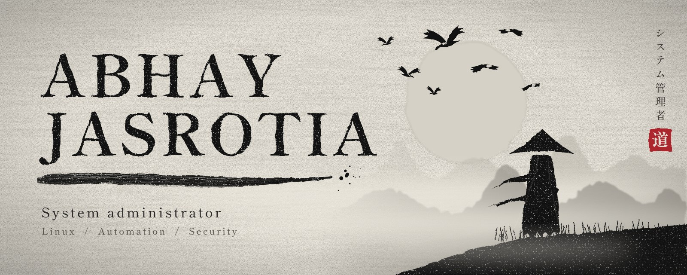
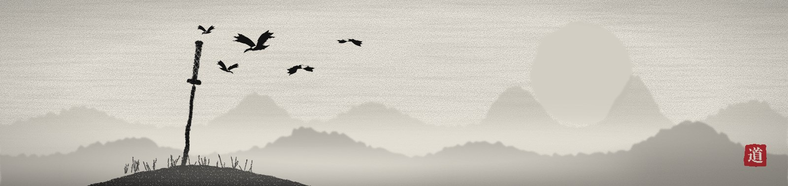

  

 

  I keep Linux servers running 
  and replace repetitive work with scripts.

  After hours I build full-stack projects 
  and study how AI can drive automation.

 

  

  

  

  <a href="https://github.com/AbhayJasrotia?tab=repositories">All repositories</a> &nbsp;·&nbsp; <a href="https://www.linkedin.com/in/abhay-jasrotia-907487236/">LinkedIn</a>

 

<i>Discipline beats motivation.</i>

  

